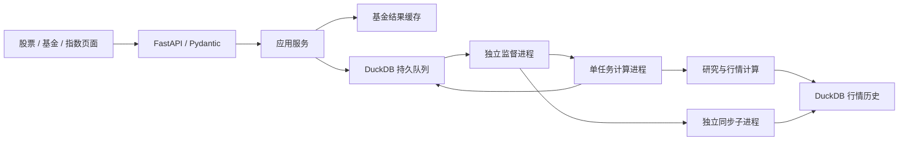

# 架构设计

核对日期：2026-11-07。当前实现为 uv + FastAPI + Uvicorn + 独立计算子进程 + DuckDB 持久任务。文件与命令详表由[模块与入口](模块与入口.md)维护，功能缺口由[功能完整性检查](功能完整性检查.md)维护。

## 模块边界

| 位置（相对 src/market_research/） | 职责 |
| --- | --- |
| api/app.py、api/routes/、api/schemas.py、api/version.py | ASGI 生命周期、路由（`/api` 兼容与 `/api/v1` 正式）、响应契约与静态资源 |
| api/static/ | 股票/基金/指数页面、数据中心、日期与下拉控件 |
| security.py | 可开关令牌认证、`Identity`（subject/tenant/scopes）与请求上下文 |
| disclosure.py | 免责声明与数据来源披露文案、作用域和展示位置 |
| audit.py | JSONL 操作审计（5MB×5 轮转、敏感字段脱敏） |
| logs.py | 应用日志轮转/级别/保留策略（Windows 下追加即关闭句柄） |
| ordering.py | 确定性排序：并列按名称或代码升序、NaN 置底、稳定排序 |
| resources.py | cgroup/亲和性感知的 CPU 预算、单任务模型并行上限与内存上限 |
| envfile.py | 可选的 `.env` 读取（仅 `FIL_ENV_FILE` 指向文件时生效，不覆盖已有环境变量） |
| services/analysis.py | 可序列化任务参数、结果缓存、阶段检查点接线与核心用例编排 |
| tasks/store.py、tasks/worker.py、tasks/processes.py | 持久任务、租约/尝试令牌、进程监督、原子去重、单实例锁与日志 |
| tasks/checkpoints.py | 阶段级检查点（按任务持久化、指纹校验、过期清理） |
| tasks/sync.py | 资产登记、已添加资产历史补齐、增量/复权刷新与同步状态 |
| market/analysis.py、market/technical.py | 股票/指数行情用例与独立技术计算 |
| funds/ | 基金分析、结果组装、RBSA、持仓与样本池 |
| modeling/ | 模型目录、单窗口估计、滚动引擎、信号、回测与趋势 |
| data/providers/、data/cache.py、data/panels.py | 数据获取、缓存、总回报校准和内存对齐 |
| data/storage.py、data/migrations/ | DuckDB 事务、内容指纹、统计及加性迁移 |
| cli/registry.py、cli/main.py、research/commands/ | 命令唯一映射、延迟加载和研究入口 |
| ops/ | 数据资产备份/校验/恢复与真实数据冒烟 |
| settings.py、config.py、validation/、serialization.py | 运行配置、研究配置、业务规则和有限数值 JSON |

`data/marketdata.py` 和 `modeling/models.py` 是稳定导入门面。核心模块不反向依赖 HTTP 层；API 与 worker 共用服务和领域实现。新增命令登记到注册表，不增加根目录 `run_*` 文件。

## 执行流

接口持久化可序列化命令与参数，不传闭包给计算进程。API 不在请求内执行长时分析。基金结果缓存命中时可直接返回；新计算通过任务轮询返回结果。

## 存储与迁移

`FIL_DATA_DIR/market.duckdb` 保存以下内容：

| 表 | 内容 |
| --- | --- |
| datasets | 数据集元信息、列类型、索引信息与 revision |
| prices | 按 dataset/date/asset 保存数值；asset 也可表示 OHLC 等字段 |
| sync_assets | 证券/口径登记、成功/尝试时间、错误及排队状态 |
| analysis_jobs | 可序列化任务、状态、租约、尝试令牌和 JSON 结果 |

基础行情表由 storage 初始化；`001_sync.sql`、`002_sync_state.sql`、`003_jobs.sql` 从包内 `data/migrations/` 顺序执行，均为可重复的加性迁移。迁移不重建既有行情。

短连接由线程锁和跨进程文件锁 `market.lock` 协调，数据集替换在事务中完成。同步另有批次锁。这里的 DuckDB 是单机存储与协调方案，不能视为支持网络盘、多主机写入的分布式数据库。

行情不再写 CSV/Parquet；旧行情 CSV 可导入且不删除。报告、研究结果、持仓和基金池仍可使用 CSV。基金计算结果使用本地版本化 pickle 缓存；任务结果使用队列表 JSON，二者生命周期不同。全局 `data_stamp()` 对所有行情数据集求摘要；基金结果指纹排除股票日线、股票同步历史及其他基金的净值/同步历史，共享指数、估值与未知数据集保守保留。计算期间指纹变化时不写结果缓存，避免旧结果绑定新数据版本；首次取数也可能因此跳过缓存。

## 任务生命周期

API 启动时初始化队列，默认启动独立 worker，文件锁确保单实例。API 退出不会停止 worker；`market-research-worker --stop` 才停止监督进程。`FIL_AUTO_SERVICES=0` 可交由外部进程管理器管理。

状态为 `queued → running → done/error`。默认队列总上限 100、分析并发 2、单次超时 900 秒。计算子进程每 5 秒续约，租约 45 秒；进程意外中断后可重新排队，默认最多 3 次尝试，正常业务异常直接失败。每次领取使用独立 token，过期进程不得覆盖新尝试或终态。

同一 `task_key` 的去重由单条 `INSERT ... SELECT ... WHERE NOT EXISTS (… status IN ('queued','running'))` 完成，插入后按 key 回读返回 `(jid, merged)`，由 DuckDB 文件锁和进程内线程锁串行化，避免并发提交各插一条。

长任务（`analyze`/`refit`/`backtest`/`holdings`）按阶段写检查点：数据对齐、净值构造、方向概率、相关性、模型拟合、行业映射等阶段完成后落盘到 `FIL_CHECKPOINT_DIR/<jid>/`，指纹包含操作、参数、窗口与数据版本。重试时只加载指纹一致且可反序列化的阶段，损坏或不一致则整体丢弃并从零执行；失败保留检查点供下次重试，任务成功后清理，超过 `FIL_CHECKPOINT_TTL_DAYS` 的目录自动删除。检查点写入是附加开销，不影响正常首轮计算失败。

资源上限：单任务模型并行数默认 `min(模型数, max(1, CPU-1))`，CPU 数按 cgroup v2/v1 配额、进程亲和性、物理核依次取值；`FIL_JOB_WORKERS`/`FIL_JOB_WORKERS_MAX` 可收紧。`FIL_JOB_MEMORY_MB` 非 0 时，POSIX 子进程设 `RLIMIT_AS`，Windows 通过 Job Object 的 `JOB_OBJECT_LIMIT_PROCESS_MEMORY` 限制；超限任务进入错误终态并给出可读原因（Windows 通常表现为进程被终止，按进程中断规则重试）。

任务状态和结果跨 API 重启保留，终态 24 小时后在下次提交时清理。取消将任务置于错误终态并由 worker 终止对应子进程；切换资产入口仅停止前端接收旧任务更新，不取消后台计算。持久队列不提供长期研究档案或历史实验列表。

## 同步生命周期与复权

worker 启动单次同步子进程，完成后约 30 秒检查下一批；独立 sync 服务及 Windows 任务也调用同一调度逻辑并共用同步锁。只处理已登记资产，不依据全市场名录扩展范围。

首次从 1990-01-01 请求可用历史；不复权股票/指数后续重取最近 10 个自然日并合并。复权股票与基金每次重建完整历史，避免公司行动和校准修订导致新旧口径混用。空数据、倒退或截断时保留旧数据，错误状态可重试。完整策略、时间配置和 Windows 安装见 [README](../README.md#数据存储与每日同步)。

## 股票技术分析边界

`market/technical.py` 是纯计算层，负责 Wilder 平滑、技术指标、因果规则和标签成熟约束下的滚动方向模型；不访问网络、数据库或 HTTP。`market/analysis.py` 读取并核对复权历史后调用。指数和基金不使用该股票技术模块。

每个预测时点仅使用标签终点不晚于当时的训练样本。标准化与分类器只拟合训练窗口，历史验证按预测周期间隔抽取成熟预测并比较当时频率基准。规则分不等于概率，Brier 优劣不等于显著性；当前是修订版历史上的滚动验证，不能称为严格时点可得回测。

## 打包与兼容

`pyproject.toml` 定义包、4 个控制台入口、Python 范围及依赖，`uv.lock` 锁定依赖。静态资源由 `market_research.api` 包资源定位，SQL 由 `market_research.data` 包资源定位，均随 wheel 发布。

`FIL_HOME` 与 `FIL_DATA_DIR` 分离源码和运行产物。旧 `src.*`、`webapp.*` 转发集中在 `compat/`，保留同一模块对象及历史 pickle 类路径。源码工作区只有两个包搜索桥接文件；wheel 直接安装兼容包。归档脚本在 `compat/entrypoints/`，源码调用方式见入口文档。

当前公开协议以 `/api/v1` 为正式路径，同一批路由同时挂在旧 `/api`（兼容、未计划立即移除）与 `/api/v1`，两套路径都出现在 `/openapi.json`。所有 HTTP 响应带 `X-API-Version: 1`，`/api/v1/health` 与 `/api/v1/ready` 的响应体含 `api_version`。关键响应由 Pydantic 契约固定：`JobResponse`（任务状态）、`ResultResponse`（结果信封）、`HealthResponse`/`ReadyResponse`（探针），FastAPI 在返回时校验并过滤未声明字段，避免字段悄悄变化。参数错误为 400，队列容量错误 429，未完成结果 202，`/api/v1/ready` 依赖异常与存储锁超时为 503（锁超时 `field=storage`、带可读原因与 `retry_after_s`）；OpenAPI 可在 `/openapi.json` 查看。不要使用历史 Flask 提案中的路由或线程执行方式描述当前后端。

## 访问控制与运行探针

默认 `FIL_ACCESS_CONTROL=off`，所有请求以本地匿名身份放行；设为 `token` 后，`AccessControl` 中间件校验 `Authorization: Bearer` 或 `X-API-Key`，失败返回 401 + `WWW-Authenticate`。身份写入 `ContextVar`，服务层通过 `current_identity()` 读取；认证模式下成功的 `analysis.run` 审计详情会带 `actor/tenant`（报告发布与数据写入记录不带）。公开路径为 `/`、`/api/health`、`/api/ready`、`/api/disclosure`、它们对应的 `/api/v1/*` 路径及 `/static/`、`/vendor/`。配额、租户数据分区与登录/OIDC 尚未实现。

`/api/v1/health` 是纯存活探针（pid、uptime、environment、access_control、api_version），不触达依赖；`/api/v1/ready` 检查 DuckDB `SELECT 1`（2 秒超时）、worker pid 存活、任务状态分布、估值面板最近同步日期（`valuation_sync.json`，阈值为 `2×FIL_DATA_STALE_DAYS`）、`storage.LOCK_STATS` 与当前资源上限（`checks.limits`：CPU、并发任务、队列、超时、模型并行与内存上限）。storage/worker/jobs 任一失败返回 503 且 `status=unhealthy`；仅同步过期返回 `degraded` + 200。Dockerfile 的 HEALTHCHECK 使用 `/api/v1/ready`。

## 结果契约、数据质量与溯源

- 基金结果 `meta` 含 `data_basis/nav_basis/nav_degraded/nav_degraded_reason`：total 口径构造失败默认抛 `NavBasisUnavailable`（`FIL_NAV_DEGRADED_POLICY=reject`），`allow_cum` 时降级为累计净值并显式标注、不写 total 缓存。研究 CLI（`funds/pipeline.run_fund`）输出同一组 `meta` 字段并在 verbose 打印口径；`research/commands/report.py` 把它们写入报告 meta，报告 hero 固定显示「总回报（分红再投资）」或「累计净值（降级）+ 原因」。
- `meta.data_quality` 统一由 `data/quality.py` 生成：`status=ok|partial|degraded|failed`、`reasons`、`stale/stale_days`、`missing_assets/n_missing/n_expected`、`source_error` 与 `provenance`（来源键/端点/抓取时间/成功与错误次数）。
- 顶层结果含 `status/ok/completeness`（`sections`、`missing[{section,item,reason}]`、`reasons`）；`/api/result` 透传 `status/completeness`，外层信封 `ok` 保持 true。CLI/报告使用同构的 `_completeness()` 并写入 `meta.json`。
- `meta.provenance` 由 `research/runinfo.result_provenance()` 生成（environment、code_version、config_version、git commit/dirty、`data_stamp`、generated_at）。`data_stamp` 是结果实际依赖的数据版本：基金类操作（analyze/backtest/refit/corr）按本基金本窗口取值（与结果缓存键同口径），market/holdings 用全局 `data_stamp()`；缓存命中读取产出时的 pickle，保留当时的版本；analyze 在计算前后各取一次，期间数据变化则跳过写缓存。
- 报告发布前执行 `validate_publish()`：主案例 `failed`、关键表缺失/为空、跨基金表样本天数与主案例偏离超过 `max(30 天, 15%)` 时默认 `raise PublishRefused`（不写文件、不覆盖旧版）；`--allow-incomplete` 强制发布并在报告顶部标注，`meta_extra.publish_gate` 记录 `{ok, problems, forced}`。
- `POST /api/holdings` 与 CLI `run.py holdings` 共用 `funds/holdings.fit_fund_holdings`，payload 含逐期暴露、基准对比与 `benchmark` 诊断（缺失行业、已映射/未映射/现金权重、`residual_treatment`）。

## 审计与运维

`audit.py` 写入 `FIL_DATA_DIR/audit.jsonl`（5MB×5 轮转，追加即关闭句柄），记录 `analysis.run`（含 job/status/completeness/模型数/耗时）、`report.publish`（门禁与强制发布）与 `data.write`（dataset/行数/列数/revision 前 12 位），敏感键统一脱敏。成功分析在认证模式下额外记录 `actor/tenant`；其余事件不记录操作者与 IP。审计不复用 24 小时任务清理；查询接口与保留期尚未提供。

`ops/backup.py` 提供 `backup|verify|restore`（`python -m market_research.ops.backup ...`）：在 `storage.connection()` 锁内 `EXPORT DATABASE ... (FORMAT PARQUET)`，`manifest.json` 记录数据集数、价格行数、revision 哈希、环境与时间；`verify` 用独立 DuckDB 读取 Parquet；`restore` 需 `--confirm`，恢复后比对 revision 哈希与价格行数。`ops/smoke.py`（入口 `scripts/smoke_real.py`）覆盖抓取→面板→分析→报告，失败按阶段分类 `data_source|logic` 并落盘 `smoke_result.json`。CI 在 `.github/workflows/ci.yml` 运行 `compileall`、`node --check` 与全量离线 unittest。详见[备份与恢复](备份与恢复.md)、[运行环境与配置](运行环境与配置.md)、[数据源供应商契约](数据源供应商契约.md)。

## 数据与研究解释

结构迁移没有消除基金月度锚点的事后校准、股票复权历史修订、披露时间缺失及简化交易成本等限制。滚动样本外预测与端到端历史时点可得收益是不同保证。历史实验日期和窗口详见[研究方案](研究方案.md)，本次结构与文档调整没有重算其数值。

## 行情覆盖信息

股票/指数分析在返回结果的 quality 中记录 requested_start/end、actual_start/end、end_gap_calendar_days、fetched_at 和 reference_missing_count/dates。缺日线仅在实际首末日之间相对可用基准统计，排除上市前和尾部区间；明细最多 10 条。calendar_verified 固定为 false，reference_checked 表示是否有可用基准用于核对，尚未接入交易所日历。页面显示请求区间及相应提示，不把周末自然日差距判为过期。

## 缺失指数恢复与元信息一致性

读取不完整的候选指数池时仅补取缺列，成功序列合并保存，补取失败保留已有行情。描述性 info 的合并在 storage 的跨进程锁内完成，避免读取旧元信息后覆盖新的数据口径。结果指纹同时包含数据 revision 和去除 info 的当前元信息，只有版本/口径变化会因元信息更新触发缓存失效，抓取时间等描述字段不会。首次使用新指纹会自然重算旧结果，无需删除行情库。
